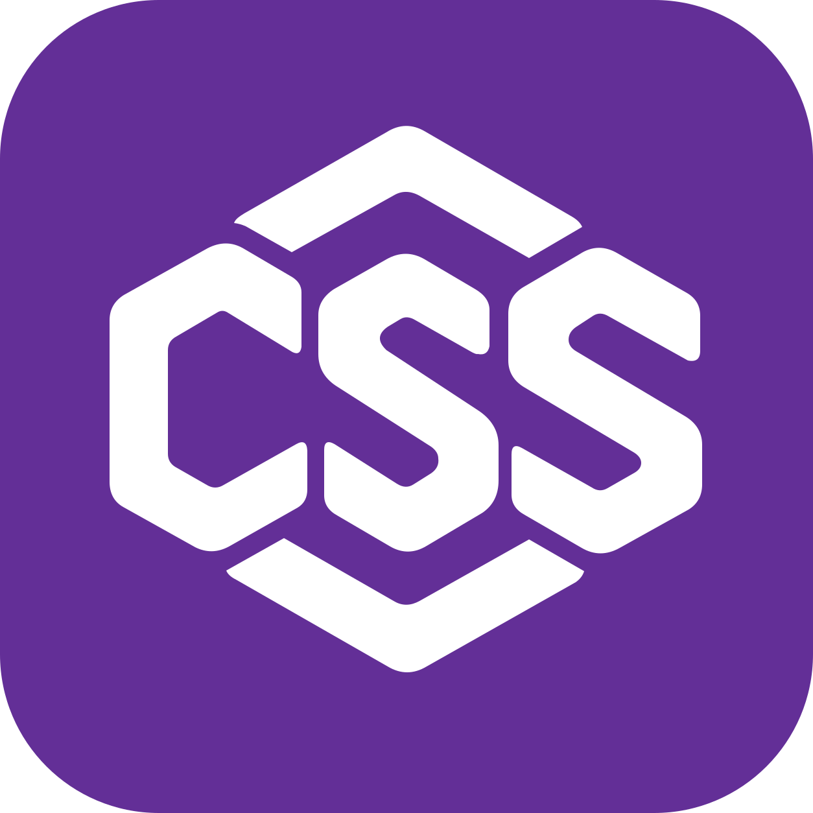

<div align="center">


<a href="https://github.com/egakareta/ecss/actions/workflows/ci.yml"></a>
<a href="https://crates.io/crates/ecss"></a>

</div>

# ecss 🐦

Add cascading style sheet (CSS) support to [egui](https://github.com/emilk/egui).

```rust,no_run
use ecss::{SelectorExt as _, Stylesheet};

fn ui(ui: &mut egui::Ui, context: &egui::Context) -> Result<(), Box<dyn std::error::Error>> {
    let css = Stylesheet::from_file("theme.css")?;
    css.install(context);
    ui.add(egui::Button::new("Save").selector(".primary"));

    Ok(())
}
```

> This library is not heavily tested and will contain bugs. Use at your own risk.

Please check out [examples](https://github.com/egakareta/ecss/tree/master/examples) to
learn more.

## License

Dual-licensed under the [MIT License](https://opensource.org/licenses/MIT) and the [Apache License, Version 2.0](https://www.apache.org/licenses/LICENSE-2.0). Choose whichever you prefer. This license only applies to ecss code.
